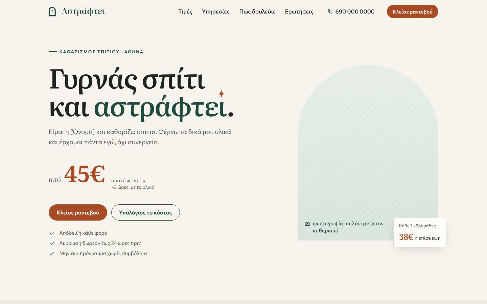
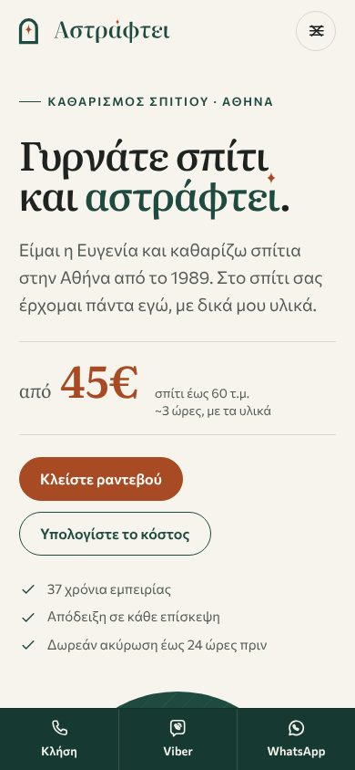

# Αστράφτει — home cleaning, Athens

Website for a one-person home cleaning business in Athens. Static site built with [Astro](https://astro.build), in Greek, hosted for free on Cloudflare.

 

Full-page screenshots: [desktop](docs/screenshots/desktop-full.jpg) · [mobile](docs/screenshots/mobile-full.jpg)

- **Costs nothing to run.** Cloudflare (hosting), Web3Forms (booking form → email) and GitHub are all free. Only the domain costs money (about €10–20/year).
- **No database.** The site doesn't need one. Prices live in a JSON file. Bookings arrive by email, phone, Viber or WhatsApp. (Turso or Cloudflare D1 would only make sense later, for something like an online booking calendar.)
- **No cookies**, so no cookie banner.

Before going live, fill in the placeholders. See **[OWNER-TODO.md](OWNER-TODO.md)**, or run `npm run check:todo`.

---

## Run it locally

You need [Node.js](https://nodejs.org) 22 or newer.

```bash
npm install
npm run dev        # http://localhost:4321, reloads as you edit
```

Other commands:

| Command              | What it does                                                         |
| -------------------- | -------------------------------------------------------------------- |
| `npm run build`      | Builds the site into `dist/`                                         |
| `npm run preview`    | Serves the built `dist/` locally                                     |
| `npm run check:todo` | Lists the placeholders still left in `src/data/site.json`            |
| `npm run flyer`      | Builds the site and saves the A5 flyer PDF to `flyer/`               |
| `npm run brand`      | Re-exports logo PNGs, favicons, social images, OG image              |

`flyer` and `brand` need Chrome or Chromium on your computer. They find Google Chrome automatically. Otherwise set `CHROME_PATH=/path/to/chrome`, or run `npx playwright install chromium` once.

---

## Edit prices

Every price is in **`src/data/pricing.json`**. Change a number, save, and the whole site updates: price cards, monthly plans, comparison table, add-ons, calculator, FAQ, structured data for Google, and the flyer.

- `services.*.prices`: price per size band (`s` ≤60 τ.μ., `m` 61–90, `l` 91–120, `xl` 120+). `null` means "price on request".
- `services.*.hours`: estimated hours per band (shown next to prices, used by the calculator).
- `plans`: monthly plans. Price per visit = base price × (1 − `discount`), rounded to whole euros. `recommended: true` gets the "Αυτό προτείνω" badge.
- `addons`: extras. `minutes` feeds the calculator's time estimate. Windows use `includedQty` + `extraEach`. Ironing uses `perHour`.
- `policies`: own-materials discount, free cancellation window, late-cancellation fee (0.5 = half price).

## Edit business details

**`src/data/site.json`**: name, phone, email, ΑΦΜ/ΔΟΥ/address (shown in the footer, as Greek law expects), payment methods, service areas, socials, form key, analytics. Anything in `[brackets]` is a placeholder.

- `contact.phone` in international format (`+3069…`), plus `phoneDisplay` for how it's shown (`690 000 0000`).
- `areas.base` with its article, as you'd say it: `"στο Παγκράτι"`, `"στη Νέα Σμύρνη"`.
- `business.insurance: true` once she has civil liability insurance. The FAQ and terms then mention it.
- `flags.showTestimonials`: see "Reviews" below.

## Edit text

Each section of the home page is one file in `src/components/sections/`, in page order:

`Hero` · `Steps` (how it works) · `Pricing` · `Services` (what's included) · `Addons` · `Estimator` (calculator) · `About` · `Testimonials` · `Areas` · `Faq` · `Contact`

The Greek copy is plain text inside the HTML, so edit it directly. The FAQ is in `src/data/faq.json`. Tokens like `{freeCancelHours}` are filled in from the price file, so the FAQ never contradicts the price list. Legal pages: `src/pages/oroi.astro` (terms) and `src/pages/politiki-aporritou.astro` (privacy).

Copy style: first person singular (it's one woman, that's the selling point), everyday Athenian Greek, short sentences, `45€` with no space.

## Add photos

Until real photos exist, the site shows tinted placeholders with a caption saying what goes there. To add a photo, drop a JPG/PNG into **`src/assets/photos/`** with one of these names:

| File name    | Where                                   | Shape                  |
| ------------ | --------------------------------------- | ---------------------- |
| `hero.jpg`   | Top of the page (bright clean room)     | portrait 4:5, arch top |
| `owner.jpg`  | "Λίγα λόγια για μένα" (her, natural)    | portrait 4:5, arch top |
| `kitchen.jpg`| Services section (clean kitchen)        | 4:3 / 4:5              |

At least 1200 px wide. Astro converts them to AVIF/WebP at several sizes automatically. Use real photos of her work, taken by phone in daylight. No stock photos.

## Reviews

The reviews section is built but hidden. When she has real reviews (with the client's permission):

1. Add them to `src/data/testimonials.json`:
   ```json
   [{ "name": "Μαρία", "area": "Παγκράτι", "text": "Το σπίτι άστραφτε. Έρχεται κάθε δεύτερη Τρίτη." }]
   ```
2. Set `"showTestimonials": true` in `src/data/site.json`.

Never invent reviews.

---

## Deploy (Cloudflare, free)

One-time setup. After that, every push to `main` redeploys automatically.

1. Go to [dash.cloudflare.com](https://dash.cloudflare.com), sign up (free), then **Workers & Pages → Create → Import a repository** (connect GitHub when asked) and pick **MommaCleaningAstraftei**.
2. On **Set up your application**:
   - Project name: `mommacleaningastraftei`. It must match `name` in `wrangler.jsonc`; if you pick a different name, change it there too.
   - Build command: `npm run build`
   - Deploy command: `npx wrangler deploy` (the default)
   - Preview builds: leave on. Pushes to other branches get their own preview URL and don't touch the live site.
   - **Advanced settings → Build variables:** `NODE_VERSION` = `22`
3. **Deploy.** The red "This Worker does not exist on this account" line under the name only means no Worker has that name yet; the first deploy creates it. After a minute or two the site is live at `https://mommacleaningastraftei.<your-account>.workers.dev`.

`wrangler.jsonc` tells Cloudflare to serve the built `dist/` folder as static files, with the custom 404 page. Static files on Workers are free and unlimited.

**Prefer Cloudflare Pages?** That works too: **Create → Pages → Connect to Git**, preset **Astro**, build command `npm run build`, output directory `dist`, `NODE_VERSION=22`. Pages ignores `wrangler.jsonc`. Use one or the other, not both.

### Connect the domain

1. Buy the domain (e.g. `astraftei.gr`) from any Greek registrar (papaki, Top.Host, Dnhost…).
2. In Cloudflare: **Add a domain** (free plan). Cloudflare gives you two nameservers. At the registrar, replace the domain's nameservers with those two. This can take a few hours.
3. In the Worker: **Settings → Domains & Routes → Add → Custom domain** → `astraftei.gr`, then again for `www.astraftei.gr`. (On Pages: **Custom domains → Set up a custom domain**.) Cloudflare creates the DNS records and the HTTPS certificate.
4. If the final address is different from `https://astraftei.gr`, update `url` in `src/data/site.json`. Canonical links, sitemap, social previews and the flyer's QR code all use it.

### Booking form (Web3Forms, free)

1. Go to [web3forms.com](https://web3forms.com), enter the email address where bookings should arrive, and confirm. You get an **Access Key**.
2. Paste it into `src/data/site.json` → `form.accessKey`.
3. Push. Submissions arrive by email (free plan: 250 per month).

Until the key is set, the form tells visitors to call or message on Viber/WhatsApp instead, so nothing gets lost.

### Analytics (optional, cookieless)

In the Cloudflare dashboard: **Web Analytics → Add a site** (or, on Pages, **Metrics → Web Analytics → Enable**). It's cookieless, so still no banner. Then set `analytics.cloudflare: true` in `site.json` so the privacy policy mentions it.

---

## Flyer

`src/pages/flyer.astro` is an A5 flyer with the logo, 4 key prices, the phone number in large type, a QR code to the site and 7 tear-off phone tabs. It reads prices, phone and URL from the same data files.

- **PDF:** `npm run flyer` → `flyer/astraftei-flyer-a5.pdf`
- **From the browser:** open `/flyer/` (locally or on the live site) → Print → A5, margins *none*, *background graphics* on. To print two per A4 sheet, choose "2 pages per sheet".

Re-run `npm run flyer` after changing the phone number, prices or domain. The PDF committed now still has placeholder details and the QR points to `astraftei.gr`. Don't print it yet.

## Brand assets

Logo, colours, fonts and usage are documented in **[BRAND.md](BRAND.md)**. Files are in `brand/`.

---

## Project structure

```
src/
  data/            site.json · pricing.json · faq.json · testimonials.json   ← edit these
  components/
    sections/      one file per home-page section
    ui/            Icon, Logo, Glint, Photo
  layouts/         Base (head, SEO, JSON-LD) · Page (legal pages)
  lib/             price helpers, contact links, structured data
  pages/           index · oroi · politiki-aporritou · 404 · flyer · sitemap.xml · robots.txt
  styles/global.css  colours, fonts, spacing as CSS variables
  assets/photos/   drop real photos here
public/            fonts (Greek + Latin subsets), favicons, og.png
brand/             logo SVG/PNG, social avatars, Facebook cover
flyer/             A5 flyer PDF + preview
scripts/           render.mjs (PNG/PDF export), build-logo.py, build-fonts.py, check-placeholders.mjs
```

Fonts: **Literata** (headings) and **Commissioner** (text), both with full Greek, self-hosted as small subsets. `scripts/build-fonts.py` rebuilds them from the `@fontsource` packages and also fixes a kerning bug in Literata's Greek ("Υ λικά" → "Υλικά").

Checked: Lighthouse mobile 98 performance, 100 accessibility / best practices / SEO; desktop 100 / 100 / 100 / 100.
